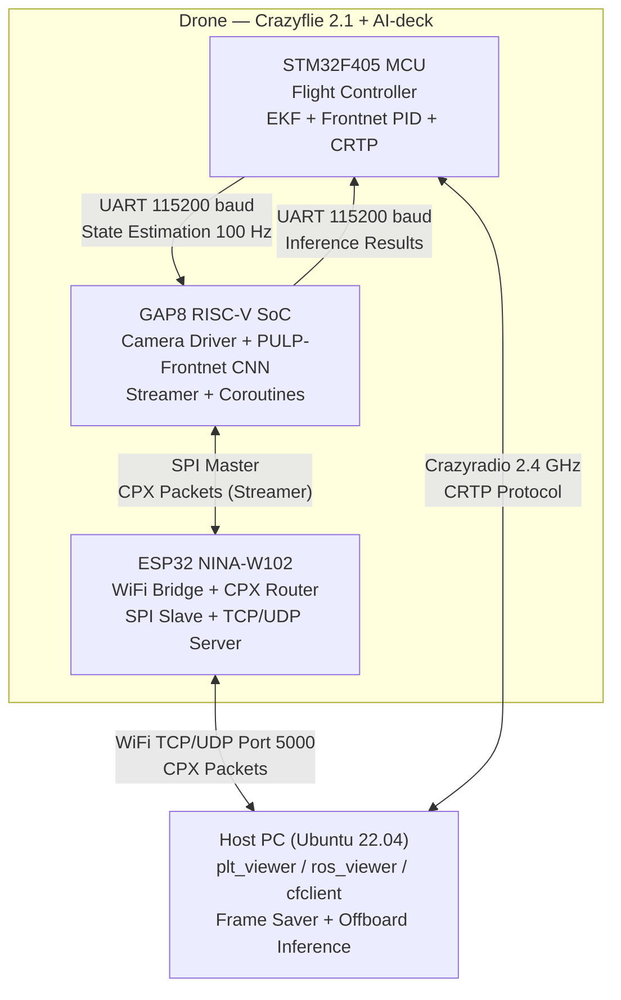
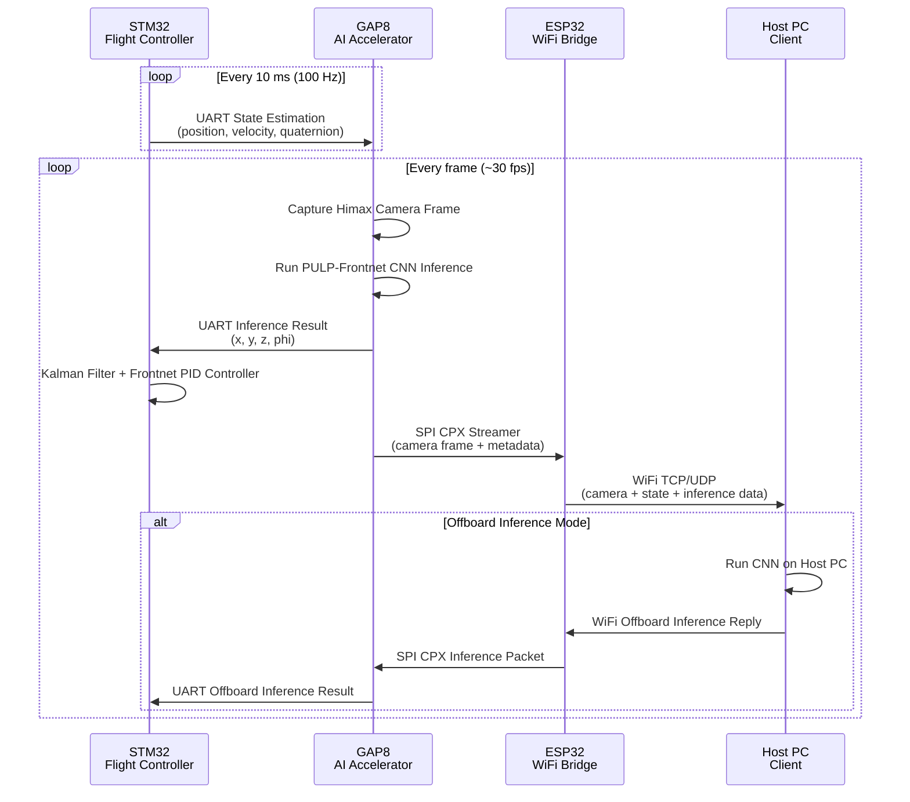

# NanoCockpit Architecture Documentation

## 1. Project Overview

NanoCockpit is a performance-optimized application framework for AI-based
autonomous nanorobotics. It is developed by IDSIA (USI/SUPSI) in collaboration
with ETH Zurich. The project targets the Bitcraze Crazyflie 2.1 nanodrone
equipped with the AI-deck expansion board, enabling on-board deep learning
inference for human pose estimation and closed-loop visual control.

**Academic reference:** Cereda, Giusti, Palossi, *arXiv 2601.07476*, 2026.

The framework provides a complete pipeline from on-chip camera capture and CNN
inference through to host-side visualization and data collection, with multiple
communication paths bridging the drone's heterogeneous hardware and the ground
station.

---

## 2. Architecture Overview

NanoCockpit employs a 4-node distributed system spanning two physical devices:
the Crazyflie 2.1 nanodrone (hosting three distinct computing nodes) and a
Host PC acting as the ground control station.

### 2.1 STM32F405 (Flight Controller)

The main microcontroller of the Crazyflie 2.1 platform. It runs FreeRTOS and
handles all low-level flight control:

- **Extended Kalman Filter (EKF):** Fuses onboard IMU, barometer, and ToF
  sensor data to estimate the drone's 3D pose, velocity, and orientation.
- **Frontnet controller:** A P controller with velocity feedforward and
  saturation clamping implementing the "follow-me" behavior — it uses CNN
  inference results (subject position relative to the drone) to compute
  target velocity setpoints.
- **State forwarding task:** Broadcasts the current drone pose (position,
  velocity, acceleration, compressed quaternion, angular rates) to the GAP8
  SoC over UART at a fixed 100 Hz rate.
- **CRTP communication:** Communicates with the Host PC via the Crazyradio PA
  USB dongle over the 2.4 GHz band using the Bitcraze CRTP protocol.
- **Inference reception:** Receives CNN inference results from the GAP8 over
  the return UART path, feeding them into the closed-loop controller.

### 2.2 GAP8 SoC (RISC-V Application Processor)

The GAP8 is a RISC-V octa-core processor with DSP extensions on the AI-deck,
dedicated to on-board computer vision and AI workloads. It runs the PMSIS/PULP
OS:

- **Himax HM01B0 camera driver:** Captures grayscale frames at configurable
  resolution (up to 324×324) and frame rate from the low-power image sensor.
- **PULP-Frontnet CNN inference:** Runs a human pose estimation network
  (160×32 input tensor) for "follow-me" subject detection and localization.
- **Camera frame + metadata streamer:** Packs captured frames, state
  estimation data, and inference results into CPX packets and sends them over
  SPI to the ESP32 for wireless transmission to the Host.
- **UART protocol:** Receives state estimation packets from the STM32 and
  sends inference results back over the same physical UART link.
- **Stackless coroutine library:** Implements cooperative multitasking with
  async/await-style programming on PMSIS tasks, enabling non-blocking
  event-driven code without additional RTOS threads.

### 2.3 ESP32 NINA-W102 (WiFi Bridge)

The ESP32 module on the AI-deck serves as a transparent network bridge between
the on-drone SPI bus and the Host PC over WiFi:

- **CPX packet router:** Routes CPX packets arriving over SPI from the GAP8
  to the appropriate WiFi socket (TCP or UDP) and vice versa.
- **SPI slave driver:** Communicates with the GAP8 over SPI, where the GAP8
  acts as master and the ESP32 as slave.
- **WiFi TCP server (port 5000):** Provides a reliable, connection-oriented
  stream for CPX packet transport.
- **WiFi UDP server:** Provides a low-latency, connectionless alternative for
  CPX packet transport.
- **mDNS hostname resolution:** Advertises the device hostname (default:
  `aideck.local`) for easy discovery on the local network.
- **Network modes:** Supports Station mode (connecting to an existing WiFi
  network) and Access Point mode (creating its own network for standalone
  operation).

### 2.4 Host PC (Client)

The ground station runs Ubuntu 22.04 with Python 3.9 and provides the user
interface, visualization, and data collection capabilities:

- **`plt_viewer`:** A Matplotlib-based GUI window that displays live camera
  feed, drone state estimation, ToF sensor readings, and CNN inference results
  in real time.
- **`ros_viewer`:** A ROS2 node that publishes camera images, odometry,
  IMU/acceleration data, and inference results as ROS2 topics for integration
  with robotic frameworks (e.g., mapping, planning).
- **`cfclient`:** The official Bitcraze client used for parameter tuning
  (21 configurable parameters in the `frontnet` group), log telemetry
  visualization, and manual flight control via the Crazyradio PA dongle.
- **Frame saver utility:** Collects datasets for offline training and
  analysis, saving captured frames as PNG images with corresponding CSV
  metadata (timestamp, state, inference).

---

## 3. Communication Flow

The system relies on five distinct communication channels bridging the four
nodes. Each channel uses a different physical transport and protocol.

### 3.1 STM32 → GAP8 (UART) — State Forwarding

The STM32 sends drone state estimation data to the GAP8 at **100 Hz** over a
UART link running at 115200 baud. The frame protocol uses a 4-byte header with
CRC32 integrity checking and carries: position in millimetres (x, y, z),
velocity in mm/s, acceleration in mm/s², compressed quaternion (int32
representation), and angular rates in mrad/s.

### 3.2 GAP8 → STM32 (UART) — Inference Results

The GAP8 sends CNN inference results back to the STM32 over the same UART
link. Each inference packet contains the estimated subject position relative to
the drone (x, y, z in metres) and the subject's yaw orientation (phi, in
radians). Additional data includes RNG entropy for cryptographic seeding and
ToF distance sensor readings forwarded from the AI-deck.

### 3.3 GAP8 → ESP32 (SPI) — CPX Transport

Communication between the GAP8 and ESP32 uses the **SPI** bus, with the GAP8
in master mode and the ESP32 in slave mode. Data is encapsulated in CPX
packets. Camera frames are split across multiple CPX packets using the
Streamer protocol: a **BUFFER_BEGIN** command announces the buffer (type, total
size, checksum), followed by one or more **BUFFER_DATA** commands carrying up
to 4092 bytes per packet (constrained by `SPI_MAX_DMA_LEN`).

### 3.4 ESP32 → Host (WiFi TCP/UDP) — CPX Forwarding

The ESP32 forwards CPX packets to the Host over WiFi. Two transport options
are available:

- **TCP (default port 5000):** Each packet is prefixed with a 2-byte length
  field, followed by the CPX header and payload.
- **UDP:** Each datagram carries a sequence number, followed by the CPX header
  and payload. UDP provides lower latency at the cost of reliability.

The ESP32 acts as a transparent router — it does not inspect or modify CPX
header fields, simply forwarding packets between SPI and WiFi.

### 3.5 Host → STM32 (CRTP via Crazyradio)

The Host communicates directly with the STM32 over the 2.4 GHz radio link
using the Bitcraze **CRTP** (Crazy RealTime Protocol) via the Crazyradio PA
USB dongle. This channel is used for:

- Parameter configuration (21 runtime-tunable parameters in the `frontnet`
  param group).
- Real-time log telemetry retrieval and plotting.
- Manual flight control commands (thrust, roll, pitch, yaw).
- Firmware updates and system-level commands.

### 3.6 Offboard Inference Path

In addition to on-board inference, the system supports an **Offboard** mode
where CNN inference is computed on the Host PC rather than the GAP8. The flow
is: camera frames are streamed from GAP8 → ESP32 → Host; the Host runs the
CNN and sends inference results back via Host → ESP32 → GAP8, which forwards
them to the STM32 via UART. This mode is useful for testing new network
architectures that exceed GAP8 memory constraints.

---

## 4. Architecture Diagrams

### 4.1 System Architecture Overview



### 4.2 PULP-Frontnet Data Pipeline



---

## 5. Key Design Patterns

### 5.1 CPX (Crazyflie Packet eXchange)

CPX is the universal packet protocol used throughout the on-drone subsystem.
It provides source and destination routing for heterogeneous inter-chip
communication. The CPX header is 2 bytes:

| Field        | Bits  | Description                                    |
|------------- |-------|------------------------------------------------|
| Source       | 3     | Originating node ID                            |
| Destination  | 3     | Target node ID                                 |
| Last Packet  | 1     | Indicates the final packet in a multi-packet transfer |
| Reserved     | 1     | Reserved for future use                        |
| Function     | 6     | Logical function identifier (e.g., STREAMER)   |
| Version      | 2     | Protocol version number                        |

Defined CPX functions include: `SYSTEM`, `CONSOLE`, `CRTP`, `WIFI_CTRL`,
`APP`, `STREAMER`, `TEST`, and `BOOTLOADER`.

### 5.2 Streamer Protocol

The Streamer protocol is built on top of CPX Function `STREAMER` (0x06). It
enables reliable multi-packet transfer of large binary buffers (such as camera
frames) across a bus with limited MTU:

- **BUFFER_BEGIN:** Announces a new buffer transfer with the buffer type
  (e.g., `IMAGE` = 0x01, `INFERENCE` = 0xF0), total payload size, and a
  CRC32 checksum for integrity verification.
- **BUFFER_DATA:** Carries a chunk of the buffer payload (up to 4092 bytes per
  packet on SPI). Multiple BUFFER_DATA packets follow a single BUFFER_BEGIN
  until the full buffer is transmitted.

### 5.3 Stackless Coroutines (GAP8)

The GAP8 firmware implements a custom stackless coroutine library that enables
cooperative multitasking within a single PMSIS task context. This allows
developers to write async/await-style non-blocking code (e.g., waiting for a
UART packet, awaiting an SPI DMA transfer) without the overhead of additional
FreeRTOS threads or the complexity of preemptive scheduling. Coroutines yield
at explicit await points, simplifying concurrency management in the
performance-constrained GAP8 environment.

### 5.4 Frontnet Controller (Follow-Me)

The Frontnet controller on the STM32 implements a P controller with velocity
feedforward for "follow-me" behavior. It receives the subject's relative
position (x, y, z) and yaw (phi) from the CNN inference pipeline and computes
velocity setpoints (x, y, z) and yaw rate. The position error is divided by
the time constant `frontnet.eta`, and the Kalman-estimated subject velocity is
added as a feedforward term. Outputs are clamped to configurable maximum
speeds and forwarded to the Crazyflie commander module for conversion into
motor commands. Controller parameters (gains, time constants, speed limits,
target distance/altitude) are exposed as 21 CRTP runtime parameters for
real-time tuning via `cfclient`.

---

## 7. GAP8 Component

The GAP8 is a RISC-V octa-core processor with DSP extensions that serves as
the AI accelerator on the AI-deck. It runs the PULP/PMSIS operating system and
executes the on-board computer vision and AI workloads, including camera frame
capture, CNN inference, data streaming, and inter-chip communication.

#### 7.1 GAP SDK and Build

The GAP8 firmware is built using GAP SDK v3.8.1, distributed as a Docker
image: `registry.gitlab.com/eliacereda/gapsdk:22.04-3.8.1`. The build system
targets the `ai_deck` configuration by default, with additional support for
`gapuino` and `gapuino_v3` boards.

| Build Command | Description |
|---|---|
| `make all run platform=gvsoc` | Compile and run in the GVSOC (GreenWaves Virtual SoC) simulator, enabling software-in-the-loop testing without physical hardware. |
| `make all run` | Compile, flash via JTAG debug probe, and run on physical hardware. |
| `make all flash` | Compile and write the firmware to the GAP8's persistent QSPI Flash memory, surviving power cycles. |

#### 7.2 Library Components (lib/)

The GAP8 firmware includes a modular library of reusable components located
under the `lib/` directory:

| File(s) | Description |
|---|---|
| `camera.h / camera.c` | Himax HM01B0 camera driver. Manages I2C configuration, frame capture via CPI interface, and double-buffering |
| `camera/himax.h / himax.c / himax_defs.h` | Himax register-level interface. All register addresses, bitfields, default values |
| `coroutine.h` | Stackless coroutine library. Enables async/await-style cooperative multitasking on PMSIS tasks. Macros: CO_FN_DECLARE, CO_FN_BEGIN, CO_WAIT, CO_FN_END |
| `queue.h / queue.c` | Async producer-consumer ring buffer. Supports synchronous and async (coroutine-aware) push/pop |
| `streamer.h / streamer.c` | CPX-based WiFi streamer. Packs camera frames + metadata (state, ToF, inference) into CPX packets, handles BUFFER_BEGIN/DATA protocol |
| `cpx/cpx.h / cpx.c` | High-level CPX API: init, send, receive, callback registration |
| `cpx/cpx_types.h` | CPX type definitions (header bit layout, node IDs, function codes) |
| `cpx/cpx_spi.h / cpx_spi.c` | CPX SPI transport layer. DMA-based SPI master driver communicating with ESP32 slave |
| `uart_protocol.h / uart_protocol.c` | Framed UART protocol with 4-byte header + CRC32. Used for STM32 state forwarding and inference return |
| `uart.h / uart.c` | Low-level UART driver (115200 baud, 8N1) |
| `cluster.h / cluster.c` | GAP8 8-core cluster management. Open/close cluster, dispatch parallel workloads |
| `crc32.h / crc32.c` | Software CRC32 checksum computation using a bytewise lookup table (ported from Bitcraze Crazyflie firmware) |
| `trace.h / trace.c` | GPIO-based profiling/tracing for real-time performance analysis |
| `trace_buffer.h / trace_buffer.c` | Trace buffer management for storing and dumping trace events |
| `rng.h / rng.c` | Entropy consumer. Maintains a 32-bit entropy pool filled externally (e.g., from STM32 over UART), used as PRNG seed |
| `soc.h / soc.c` | SoC configuration: voltage (800-1200mV), fabric controller frequency, cluster frequency |
| `list.h` | Generic intrusive singly-linked list utility |
| `event_group.h` | Event group synchronization primitive |
| `debug.h / debug.c` | Debug helpers (assertions, panic handlers) |
| `time.h / time.c` | Time utilities (us/ms timers, sleep) |
| `utils.h` | Utility macros (MIN, MAX, ARRAY_SIZE, etc.) |

#### 7.3 Examples

The GAP8 firmware ships with 6 example projects that demonstrate individual
library components and the full application pipeline.

##### 7.3.1 pulp-frontnet (Full CNN Demo)

Full PULP-Frontnet demonstration. Captures camera frames, runs CNN inference
(either onboard or offboard), streams to host over WiFi, and sends inference
results to STM32 over UART for closed-loop control.

**Path:** `src/gap/examples/pulp-frontnet/`

**Build:** `cd examples/pulp-frontnet && make clean && make all flash`
**GVSOC test:** `make all run platform=gvsoc`

**Config file:** `config.h`

**General Settings:**

| Parameter | Default | Description |
|---|---|---|
| `VERBOSE` | enabled | General debug prints |
| `NETWORK_ONBOARD_INFERENCE` | enabled | Run inference on GAP8 (disable for offboard) |
| `NETWORK_TEST_INPUT` | enabled | Run inference on hardcoded test image, verify checksum |
| `NETWORK_PROFILE` | disabled | Profile network inference timing |
| `STREAMER_DISABLE` | disabled | If enabled, skip WiFi streaming |

**SoC Settings:**

| Parameter | Default | Description |
|---|---|---|
| `SOC_VOLTAGE` | 1200 | SoC voltage in mV |
| `SOC_FREQ_FC` | 246000000 | Fabric controller frequency (Hz) |
| `SOC_FREQ_CL` | 175000000 | Cluster frequency (Hz) |
| `BOARD` | 0 | 0=AI-deck, 1=GAPuino/lab |

**Camera (Himax) Settings:**

| Parameter | Default | Description |
|---|---|---|
| `HIMAX_FORMAT` | 2 | Resolution: 0=FULL(324x324), 1=QVGA(324x244), 2=HALF(162x162), 3=QQVGA(162x122) |
| `HIMAX_FQCY` | 6000000 | Camera clock (6 MHz) |
| `HIMAX_FRAME_RATE` | 30.0 | Desired fps (format-dependent max: FULL~45, QVGA~60, HALF~90, QQVGA~120) |
| `HIMAX_AE` | 0 | Auto-exposure: 0=off, 1=on |
| `HIMAX_INTEGRATION_MS` | 10.0 | Manual integration time (ms) |
| `HIMAX_AGAIN` | 0x10 | Analog gain (1x-16x) |
| `HIMAX_DGAIN` | 0x0100 | Digital gain |
| `HIMAX_ORIENTATION` | 0x03 | Image orientation |
| `HIMAX_SYS_DIV` | 0 | System clock divider: 0=/1, 1=/2, 2=/4, 3=/8 |
| `HIMAX_REG_DIV` | 0 | Register clock divider |
| `CAMERA_BUFFERS` | 2 | Number of frame buffers (1 or 2) |
| `CAMERA_CROP_TOP/LEFT/RIGHT/BOTTOM` | 1 or 2 (format-dependent) | Crop pixels per edge |

**Format-dependent max framerates (at 6 MHz MCLK):**

| Format | Resolution | Max fps |
|---|---|---|
| 0 (FULL) | 324x324 | ~46 |
| 1 (QVGA) | 324x244 | ~61 |
| 2 (HALF) | 162x162 | ~164 |
| 3 (QQVGA) | 162x122 | ~218 |

**CPX/Streamer Settings:**

| Parameter | Default | Description |
|---|---|---|
| `CPX_SPI_BIDIRECTIONAL` | disabled | Enable bidirectional GAP8↔ESP32 SPI |
| `STREAMER_SEND_CHECKSUM` | disabled | CRC32 on sent buffers |
| `STREAMER_RECEIVE_CHECKSUM` | enabled | Verify CRC32 on received buffers |

**Network Model:**
- `NETWORK_NAME` = `frontnet-160x32-bgaug` (defined in `app/app.mk`)
- Input: 160x32 grayscale
- Output: 4 floats (x, y, z, phi)

##### 7.3.2 streamer (Camera + State Streamer)

Minimal camera + state estimation WiFi streamer. No CNN inference. Captures
frames from Himax camera, receives state estimation from STM32 over UART,
packs them into CPX streamer packets, and sends via SPI to ESP32 for WiFi
transmission.

**Path:** `src/gap/examples/streamer/`

**Build:** `cd examples/streamer && make clean && make all flash`

Same config parameters as pulp-frontnet, EXCEPT: no NETWORK_* defines, and
`STREAMER_VERBOSE` is disabled by default (commented out).

##### 7.3.3 cpx (CPX Protocol Test)

Low-level CPX communication example. Sends example CPX packets (CMD_1 with
uint32, CMD_2 with float) every 500ms using a coroutine. Tests SPI
communication with ESP32.

**Path:** `src/gap/examples/cpx/`

**Build:** `cd examples/cpx && make clean && make all run`

**Config (`config.h`):**

| Parameter | Default | Description |
|---|---|---|
| `VERBOSE` | enabled | General debug prints |
| `CPX_VERBOSE` | enabled | CPX debug prints |
| `CPX_SPI_VERBOSE` | enabled | CPX SPI debug prints |
| `CPX_SPI_BIDIRECTIONAL` | enabled | Bidirectional SPI |

##### 7.3.4 coroutine (Coroutine Pattern)

Demonstrates the stackless coroutine library usage pattern. Sets SoC frequency
to 100 MHz and runs a simple coroutine example.

**Path:** `src/gap/examples/coroutine/`

**Build:** `cd examples/coroutine && make clean && make all run`

**Config (`config.h`):**

| Parameter | Default | Description |
|---|---|---|
| `CO_VERBOSE` | disabled | Coroutine debug prints |

##### 7.3.5 queue (Synchronous Queue)

Demonstrates the synchronous producer-consumer queue with a ring buffer of
size 3 (int elements).

**Path:** `src/gap/examples/queue/`

**Build:** `cd examples/queue && make clean && make all run`

**Config (`config.h`):**

| Parameter | Default | Description |
|---|---|---|
| `QUEUE_VERBOSE` | enabled | Queue debug prints |

##### 7.3.6 queue_async (Async Queue)

Demonstrates the asynchronous producer-consumer queue using coroutines. Ring
buffer of size 3 with coroutine-aware push/pop operations.

**Path:** `src/gap/examples/queue_async/`

**Build:** `cd examples/queue_async && make clean && make all run`

**Config (`config.h`):**

| Parameter | Default | Description |
|---|---|---|
| `QUEUE_VERBOSE` | enabled | Queue debug prints |

## 8. STM32 Component

The STM32F405 MCU on the Crazyflie main board runs the PULP-Frontnet low-level
controller — a "follow-me" application that receives CNN inference results,
smooths them with a Kalman filter, and computes flight setpoints via a P
controller with velocity feedforward. The firmware is built on a fork of
Bitcraze **crazyflie-firmware v2021.06**.

### 8.1 Build Instructions

```shell
cd src/stm32/app && make clean all && make cload
```

Optional: specify radio URI for over-the-air flashing:
```shell
make cload CLOAD_ARGS="-w radio://0/100/2M/E7E7E7E7E7"
```

The Makefile (`src/stm32/app/Makefile`) compiles 8 application object files
and links them against the Crazyflie base firmware:

| Source File | Description |
|---|---|
| `frontnet_main.c` | Main FreeRTOS task: inference queue consumer, Kalman filter loop, controller setpoint computation |
| `frontnet_kf.c` | 4-axis Kalman filter (x, y, z, phi) for subject pose smoothing and velocity estimation |
| `frontnet_ctrl.c` | P controller with velocity feedforward and saturation clamping |
| `frontnet_state_fwd.c` | Periodically forwards drone state estimation to GAP8 over UART |
| `frontnet_aideck_protocol.c` | AI-deck UART protocol bridge — receives inference packets from GAP8 |
| `frontnet_appchannel.c` | CRTP app channel receiver — alternative inference path from Host via Crazyradio |
| `frontnet_rng.c` | RNG entropy source for GAP8 — collects sensor noise as entropy |
| `frontnet_test_inferences.c` | Hardcoded test inference sequences for offline controller validation |

The Makefile forces the `bcAI` deck driver (`-DDECK_FORCE=bcAI`) which
initializes the UART link to the AI-deck at 115200 baud.

### 8.2 FreeRTOS Task Architecture

Three FreeRTOS tasks run the application:

| Task Name | Stack Size | Priority | Function |
|---|---|---|---|
| `FRONTNET` | 2× minimal | 1 | Main controller task. Receives inference via queue, runs Kalman filter, computes setpoints, applies to commander |
| `FN-APPCHANNEL` | 1× minimal | 1 | CRTP app channel handler. Alternative inference reception from Host |
| `STATE-FWD` | 2× minimal | 1 | State forwarding to GAP8. Reads latest EKF state and sends over UART at 100 Hz |

### 8.3 Compile-Time Configuration

All compile-time constants are defined in `src/stm32/app/include/frontnet_config.h`:

**Timing and Control:**

| Constant | Value | Description |
|---|---|---|
| `FRONTNET_TIMER_RATE` | 100 | Controller timer tick rate (Hz) |
| `FRONTNET_INFERENCE_TIMEOUT` | 750 ms | Time since last inference before disabling control |
| `FRONTNET_INFERENCE_RATE_PERIOD` | 1000 ms | Window for computing average inference rate |
| `FRONTNET_COMMAND_TIMEOUT` | 500 ms | Queue receive timeout |
| `FRONTNET_MIN_BATTERY_VOLTAGE` | 2.9 V | Minimum battery voltage before control is disabled |
| `STATE_FWD_RATE` | 100 | State forwarding rate to GAP8 (Hz) |
| `STATE_FWD_HISTORY_COUNT` | 100 | State history buffer size |
| `FRONTNET_SETPOINT_PRIORITY` | CRTP+1 | Setpoint priority so autonomous control overrides manual |

**Default Kalman Filter Configuration (per axis):**

| Axis | angle mode | r_xx (measurement noise) | q_vv (process noise) | p_xx (initial cov.) | p_vv (initial cov.) |
|---|---|---|---|---|---|
| X | no | 0.012 | 16.0 | 100.0 | 10.0 |
| Y | no | 0.012 | 16.0 | 100.0 | 10.0 |
| Z | no | 0.024 | 6.0 | 100.0 | 10.0 |
| Phi (yaw) | **yes** | 0.080 | 16.0 | 10.0 | 10.0 |

The Phi axis uses angular mode because yaw wraps around at 2π radians.

**Default Target Pose:**

| Parameter | Default | Description |
|---|---|---|
| `horizontalDistance` | 1.5 m | Target horizontal distance from subject |
| `altitude` | 1.4 m | Target flight altitude |
| `altitudeReference` | GROUND | Altitude reference mode (ground-relative) |

**Default Controller Parameters:**

| Parameter | Default | Description |
|---|---|---|
| `linearTau` | 1.0 | Linear velocity time constant |
| `linearK` | 1.0 | Linear velocity P gain |
| `angularTau` | 0.5 | Angular velocity time constant |
| `maxHorizontalSpeed` | 4.8 m/s | Horizontal speed limit |
| `maxVerticalSpeed` | 0.8 m/s | Vertical speed limit |
| `maxAngularSpeed` | 2.0 rad/s | Yaw rate limit |

### 8.4 Runtime Parameters (CFclient `frontnet` Group)

The STM32 exposes **21 runtime-tunable parameters** accessible via the CFclient
GUI or programmatically over CRTP. These allow real-time adjustment without
recompilation.

**Control and Debug:**

| Parameter | Type | Default | Description |
|---|---|---|---|
| `frontnet.enable_control` | uint8 | 0 | Enable/disable autonomous control (safety switch) |
| `frontnet.verbose` | uint8 | 0 | Enable verbose debug output over UART |
| `frontnet.infer_t_state` | uint8 | 1 | Use state estimation timestamp from inference (1=yes) |

**Kalman Filter (per-axis measurement and process noise):**

| Parameter | Type | Default | Description |
|---|---|---|---|
| `frontnet.kalman_x_r` | float | 0.012 | X-axis measurement noise |
| `frontnet.kalman_x_q` | float | 16.0 | X-axis process noise |
| `frontnet.kalman_y_r` | float | 0.012 | Y-axis measurement noise |
| `frontnet.kalman_y_q` | float | 16.0 | Y-axis process noise |
| `frontnet.kalman_z_r` | float | 0.024 | Z-axis measurement noise |
| `frontnet.kalman_z_q` | float | 6.0 | Z-axis process noise |
| `frontnet.kalman_phi_r` | float | 0.080 | Phi-axis measurement noise |
| `frontnet.kalman_phi_q` | float | 16.0 | Phi-axis process noise |

**Target Pose:**

| Parameter | Type | Default | Description |
|---|---|---|---|
| `frontnet.distance` | float | 1.5 | Target horizontal distance from subject (m) |
| `frontnet.altitude` | float | 1.4 | Target altitude (m) |
| `frontnet.rel_altitude` | uint8 | 0 | Altitude reference: 0=ground, 1=subject-relative |

**Controller Gains and Limits:**

| Parameter | Type | Default | Description |
|---|---|---|---|
| `frontnet.eta` | float | 1.0 | Linear velocity time constant (tau) |
| `frontnet.k` | float | 1.0 | Linear velocity P gain |
| `frontnet.rotation_tau` | float | 0.5 | Angular velocity time constant |
| `frontnet.max_speed` | float | 4.8 | Maximum horizontal speed (m/s) |
| `frontnet.max_vert_speed` | float | 0.8 | Maximum vertical speed (m/s) |
| `frontnet.max_ang_speed` | float | 2.0 | Maximum angular speed (rad/s) |

**Safety:**

| Parameter | Type | Default | Description |
|---|---|---|---|
| `frontnet.min_voltage` | float | 2.9 | Minimum battery voltage (V) — control disabled below this |

### 8.5 Log Group (`frontnet` Telemetry)

The `frontnet` log group provides read-only telemetry for real-time monitoring
in CFclient. The STM32 periodically transmits these values over CRTP.

**Control Status:**

| Log Variable | Type | Description |
|---|---|---|
| `control_enabled` | uint8 | Control enable flag (runtime parameter) |
| `control_active` | uint8 | Control active flag (all conditions met: enabled, recent inference, battery OK) |
| `lastUpdate` | uint32 | Timestamp of last inference update |
| `update_frequency` | uint8 | Average inference rate (Hz) computed over the observation window |
| `inf_latency` | uint32 | End-to-end inference pipeline latency (ms) |

**Raw Inference Output:**

| Log Variable | Type | Description |
|---|---|---|
| `x` | float | Raw CNN output — subject X position |
| `y` | float | Raw CNN output — subject Y position |
| `z` | float | Raw CNN output — subject Z position |
| `phi` | float | Raw CNN output — subject yaw orientation |

**Kalman Filtered Output:**

| Log Variable | Type | Description |
|---|---|---|
| `f_x` | float | Filtered subject X position |
| `f_y` | float | Filtered subject Y position |
| `f_z` | float | Filtered subject Z position |
| `f_phi` | float | Filtered subject yaw orientation |
| `f_vx` | float | Filtered subject X velocity |
| `f_vy` | float | Filtered subject Y velocity |
| `f_vz` | float | Filtered subject Z velocity |
| `f_vphi` | float | Filtered subject yaw angular velocity |

### 8.6 Control Pipeline

The STM32 control loop runs at 100 Hz (every 10 ms):

1. **Receive inference** — CNN inference result arrives from GAP8 over UART
   (or from Host over CRTP app channel). Each inference contains the subject's
   estimated position (x, y, z in metres) and yaw angle (phi in radians)
   relative to the drone's body frame.
2. **Kalman filter update** — Four independent 1D Kalman filters (x, y, z,
   phi) smooth the noisy CNN measurements and estimate subject velocity.
3. **Timeout check** — If more than 750 ms have passed since the last
   inference, the controller is deactivated to prevent stale data from causing
   unsafe maneuvers.
4. **Target pose computation** — The target drone position is computed by
   projecting backwards from the subject along the estimated line-of-sight, at
   the configured horizontal distance (`frontnet.distance`, default 1.5 m) and
   altitude (`frontnet.altitude`, default 1.4 m). When `frontnet.rel_altitude`
   is set to 1, the altitude becomes relative to the subject's estimated
   height rather than ground level.
5. **P controller** — A P controller computes velocity setpoints (x, y, z)
   and yaw rate. The position error between the drone and the target is
   divided by the time constant `frontnet.eta` (default 1.0), and the
   Kalman-estimated subject velocity is added as a feedforward term
   multiplied by `frontnet.k` (default 1.0). The resulting velocity
   commands are clamped to the configured maximum speeds. The Crazyflie
   commander module then converts these velocity setpoints into roll,
   pitch, and thrust commands using the standard attitude and rate
   controllers.
6. **Commander setpoint** — The velocity setpoint is pushed to the Crazyflie
   pushed to the Crazyflie commander module with priority `CRTP+1`, ensuring
   autonomous commands override manual remote control inputs. The commander
   module applies the standard Crazyflie attitude and rate controllers to
   convert setpoints into motor PWM signals.

## 9. ESP32/NINA Component

The ESP32 NINA-W102 module on the AI-deck serves as a transparent CPX packet
router between the GAP8's SPI bus and the Host PC's WiFi network. It does
**not** inspect or modify CPX payloads — its sole role is forwarding.

### 9.1 Build Instructions

The firmware uses ESP-IDF v5.3.3, distributed as a Docker image:
`registry.gitlab.com/eliacereda/espidf:22.04-5.3.3`.

```shell
cd src/nina && esp 5.3.3
idf.py menuconfig && idf.py all
```

Flash over JTAG with Olimex ARM-USB-OCD-H:
```shell
openocd -f interface/ftdi/olimex-arm-usb-ocd-h.cfg \
        -f board/esp-wroom-32.cfg \
        -c "adapter_khz 20000" \
        -c 'program_esp build/partition_table/partition-table.bin 0x8000 verify' \
        -c 'program_esp build/bootloader/bootloader.bin 0x1000 verify' \
        -c 'program_esp build/aideck_cpx_streamer.bin 0x10000 verify reset exit'
```

### 9.2 Source Files

| File | Description |
|---|---|
| `main/main.c` | Application entry point. Initializes Wi-Fi, SPI slave, CPX routing tasks, LED status |
| `main/config.h` | Compile-time configuration: FreeRTOS task core/priority assignments, GPIO pin mappings |
| `main/cpx_spi.c / .h` | SPI slave driver. Receives CPX packets from GAP8 (master) and queues replies |
| `main/cpx_wifi.c / .h` | CPX over Wi-Fi transport. TCP server (port 5000) and UDP server for Host communication |
| `main/cpx_types.h` | Shared CPX protocol type definitions (header layout, node IDs, function codes) |
| `main/trace_buffer.c / .h` | Synchronized trace buffer for event logging |
| `main/soc.h` | SoC utilities (restart reason, heap info) |
| `main/utils.h` | Utility macros |

### 9.3 FreeRTOS Task Architecture

Eight FreeRTOS tasks run on the ESP32's two cores (Core 0 for LED, Core 1 for
everything else):

| Task | Core | Priority | Function |
|---|---|---|---|
| `led` | 0 | 2 | LED status indicator. Blinks based on two conditions: `source_alive` (GAP8 CPX packets arriving) and `connected` (Host TCP connection active). Fast blink (100/100ms) = both OK, slow (500/500ms) = source alive but no Host, asymmetric (1000/200ms) = Host connected but source dead, very slow (2000/2000ms) = neither |
| `wifi_status_task` | 1 | 3 | Monitors Wi-Fi connection state. Reconnects if disconnected, prints IP address on connect |
| `cpx_router_spi_task` | 1 | 3 | SPI→WiFi router. Reads CPX packets from SPI RX queue, dispatches to TCP or UDP socket based on connection state |
| `cpx_router_wifi_task` | 1 | 3 | WiFi→SPI router. Receives CPX packets from WiFi sockets and queues them for SPI transmission to GAP8 |
| `Wi-Fi TCP RX` | 1 | 4 | TCP server for CPX packet transport. Accepts Host connections, provides reliable ordered stream with reconnect logic |
| `Wi-Fi UDP RX` | 1 | 4 | UDP server for CPX packet transport. Lower latency, connectionless alternative to TCP |
| `SPI TX/RX` | 1 | TCPIP+1 | SPI slave driver task. Handles DMA-based SPI transactions with GAP8. Pushes received packets into router queue and sends queued replies back over SPI |
| `trace_dump_task` | 1 | 24 | Trace buffer dump. Outputs collected trace events via GPIO for external logic analyzer |

### 9.4 SPI Pin Mapping

Due to a design constraint on the AI-deck PCB, the ESP32's MISO and MOSI pins
are **swapped** relative to the ESP32 documentation. This forces all SPI
signals through the GPIO matrix instead of using the dedicated SPI peripheral,
limiting the maximum SPI clock to **7.2 MHz**.

| GPIO | NINA-W102 Pin | Signal | Notes |
|---|---|---|---|
| 19 | Pin 21 (SPI_V_MISO) | MOSI | Swapped — normally MISO |
| 23 | Pin 1 (SPI_V_MOSI) | MISO | Swapped — normally MOSI |
| 18 | Pin 29 (SPI_V_CLK) | SCLK | SPI clock |
| 5 | Pin 28 (SPI_V_CS) | CS | SPI chip select |
| 4 | Pin 24 (RMII_MDIO) | LED | Status LED (active low) |
| 2 | Pin 25 (RMII_MDCLK) | NINA_RTT | NINA→GAP8 ready-to-transmit |
| 32 | Pin 5 | GAP_RTT | GAP8→NINA ready-to-transmit |
| 0 | Pin 27 (RMII_CLK / SYS_BOOT) | TRACE_DUMP | Trace dump signal output |

### 9.5 WiFi Configuration

The ESP32 supports two network modes, configured at build time via
`idf.py menuconfig`:

**Station Mode (STA)** — recommended for lab use. The ESP32 connects to an
existing WiFi network. Default credentials:
- SSID: `drone_wifi`
- Password: `wifi-wifi`

**Access Point Mode (AP)** — for standalone operation without existing
infrastructure. The ESP32 creates its own open WiFi network:
- SSID: `crazyflie`
- No password (open network)

In both modes, the ESP32 advertises its hostname via mDNS for easy Host
discovery. The default hostname is `aideck.local` (configurable in
menuconfig).

### 9.6 CPX Routing Architecture

The ESP32 implements a bridge between two physical transports:

1. **SPI (GAP8 side)** — The `CPX_SPI` task handles DMA-based SPI slave
   transactions. When the GAP8 (master) initiates a transfer, the ESP32
   receives CPX packets and pushes them into a shared RX queue.

2. **WiFi (Host side)** — Two concurrent transports serve the Host:
   - **TCP** (`CPX_TCP` task): Accepts a single connection from the Host.
     Provides reliable, ordered delivery with TCP_NODELAY for low latency.
     Handles reconnection transparently on disconnect.
   - **UDP** (`CPX_UDP` task): Provides lower-latency delivery at the cost
     of reliability. Packets carry a 16-bit sequence number for duplicate
     detection on the receiving end.

The **CPX_ROUTER** task reads from the SPI RX queue and dispatches each
packet to the appropriate WiFi socket. Packets arriving from WiFi are
forwarded directly to the SPI TX queue for delivery to GAP8.

The ESP32 does **not** interpret CPX routing headers (source/destination
fields) — it forwards everything. The GAP8 and Host are responsible for
filtering packets addressed to them.

## 10. Client Components

The Host PC runs Python 3.9 on Ubuntu 22.04 and provides three client tools
for visualization, data collection, and drone control. Installation:

```shell
pip install -e src/client/aideck_cpx_streamer -e src/client/crazyflie-clients-python
```

This registers two console entry points: `plt_viewer` and `ros_viewer`.

### 10.1 Package Structure

| Package / Module | Description |
|---|---|
| `aideck_cpx_streamer` | Main Python package. GUI viewer, ROS2 viewer, CPX client, transport layer, utilities |
| `cpx/cpx.py` | `CPXClient` — high-level CPX send/receive with callback support |
| `cpx/streamer.py` | `StreamerClient` — streamer protocol wrapper. Reassembles multi-packet buffers (BUFFER_BEGIN + BUFFER_DATA), decodes frames from `StreamerMetadata` + raw pixels, computes FPS and RTT stats |
| `cpx/transport/tcp.py` | `TCPClientTransport` — TCP socket with keep-alive, NODELAY, LINGER. Packs CPX packets as `TCPHeader(length+CPXHeader) + payload`. MTU: 4092 − TCPHeader |
| `cpx/transport/udp.py` | `UDPClientTransport` — UDP socket with sequence numbers for duplicate detection. Packs CPX packets as `UDPHeader(sequence+CPXHeader) + payload` |
| `cpx/transport/multi.py` | `MultiClientTransport` — combines TCP (receive) + UDP (send) for asymmetric operation |
| `utils/frame_saver.py` | `FrameSaver` + `InferenceSaver` — save frames as PNG/JPEG + CSV metadata for dataset creation |
| `utils/quatcompress.py` | Decompresses int32 quaternion representation from STM32 state forwarding |
| `utils/thread_pool.py` | `ThreadPool` — worker pool for async offboard reply sending |
| `utils/ros.py` | ROS2 message conversion utilities |
| `aideck_cpx_msgs` | ROS2 custom message package: `CPXPacket`, `CPXHeader`, `ImageMetadata`, `Inference` |

### 10.2 plt_viewer (Matplotlib GUI)

A lightweight real-time GUI displaying live camera feed, drone state
estimation, ToF sensor readings, and CNN inference results.

**Invocation:**
```shell
plt_viewer [-host HOSTNAME] [-port PORT] [--no-udp-send] [-save DIR]
```

**Command-line parameters:**

| Argument | Type | Default | Description |
|---|---|---|---|
| `-host` | string | `aideck.local` | AI-deck hostname or IP address |
| `-port` | int | `5000` | AI-deck TCP port |
| `--no-udp-send` | flag | off | Disable UDP reply sending to the drone (keeps TCP-only) |
| `-save` | string | (none) | Enable dataset saving to the specified output directory |

With `-save dataset/`, the client creates a timestamped subdirectory
(`dataset/YYYY-MM-DD-HH-MM-SS/`) containing:
- `camera_raw/` — raw grayscale PNG images
- `camera_rgb/` — debayered color JPEG images
- `tof/` — ToF sensor PNG frames (if available)
- `metadata.csv` — per-frame metadata (timestamp, state estimation, quaternion)

### 10.3 ros_viewer (ROS2 Node)

A ROS2 node that publishes camera images, odometry, acceleration, and
inference data as standard ROS2 topics. Designed for integration with robotic
frameworks (SLAM, planning, visualization).

**Invocation:**
```shell
ros2 launch aideck_cpx_streamer ros_viewer_launch.xml [host:=HOSTNAME]
```

**Launch file parameters (`ros_viewer_launch.xml`):**

| Parameter | Default | Description |
|---|---|---|
| `host` | `aideck.local` | AI-deck hostname or IP |
| `save_dir` | `<pkg>/data` | Directory for dataset saving (empty string disables saving) |

**Published ROS2 Topics:**

| Topic | Type | Description |
|---|---|---|
| `cf/image_raw` | `sensor_msgs/Image` | Grayscale camera frame |
| `cf/image_metadata` | `aideck_cpx_msgs/ImageMetadata` | Frame metadata (version, timestamp, RTT stats) |
| `cf/image_odom` | `nav_msgs/Odometry` | Drone pose + velocity + orientation (from state estimation) |
| `cf/image_accel` | `geometry_msgs/AccelWithCovarianceStamped` | Drone linear acceleration |
| `cf/tof_raw` | `sensor_msgs/Image` | ToF distance sensor frame (if available) |
| `cf/inference_onboard` | `aideck_cpx_msgs/Inference` | Onboard CNN inference results (x, y, z, phi) |
| `cf/cpx` | `aideck_cpx_msgs/CPXPacket` | Raw CPX packets (for debugging) |

**Subscribed ROS2 Topics:**

| Topic | Type | Description |
|---|---|---|
| `cf/inference` | `aideck_cpx_msgs/Inference` | Offboard inference results from an external ROS2 node. Sent back to drone as CPX reply |

The ROS2 viewer operates in a namespace (`/cf`) to isolate multiple drone
streams. When `save_dir` is set, the viewer saves datasets using the same
format as `plt_viewer -save`, with an additional `inference.csv` file
recording offboard inference results, send success status, and inference
latency.

### 10.4 StreamerClient Data Flow

The `StreamerClient` class (`cpx/streamer.py`) is the core data ingestion
layer used by both viewers:

1. **CPX receive** — `CPXClient` reads TCP/UDP transport, filters packets by
   function `STREAMER` (0x06).
2. **Streamer reassembly** — Multi-packet buffers are reassembled:
   `BUFFER_BEGIN` (type, size, CRC32 checksum) followed by one or more
   `BUFFER_DATA` chunks. CRC32 integrity is verified on completion.
3. **Frame decoding** — `StreamerMetadata` struct is parsed from the buffer
   header (metadata_version, frame dimensions, timestamps, state estimation,
   ToF data, inference result, RTT reply fields). The remaining buffer is
   reshaped into a NumPy grayscale image array.
4. **FPS/RTT computation** — A 1-second timer accumulates metadata_stats and
   computes frames-per-second, dropped frame count, and round-trip latency
   (if `CPX_SPI_BIDIRECTIONAL` is enabled on GAP8).
5. **Offboard reply** — Optionally sends `OffboardBuffer` (frame ID +
   inference output) back to the drone over UDP for RTT measurement or
   offboard inference loop.

### 10.5 Transport Layer

The CPX transport layer (`cpx/transport/`) abstracts WiFi communication:

- **`MultiClientTransport`** — Default for `plt_viewer`. Opens TCP for
  receiving (reliable ordered stream with automatic reconnection) and UDP for
  sending (lower latency for offboard replies). Set `--no-udp-send` to disable
  UDP and use TCP-only.
- **`TCPClientTransport`** — TCP socket with `SO_KEEPALIVE` (1s idle, 1s
  interval, 5 retries), `TCP_NODELAY` for low latency, `SO_LINGER` (5s) for
  graceful close. Automatic reconnection on connection loss, timeout, or
  reset.
- **`UDPClientTransport`** — UDP socket bound to an ephemeral local port and
  `connect()`ed to the remote drone. Sends with incrementing 16-bit sequence
  number. Receives with duplicate detection (drops out-of-order packets).

### 10.6 Frame Saver Utilities

## 11. Docker Build Environments

NanoCockpit uses two Docker containers to provide reproducible build
environments without installing the GAP SDK or ESP-IDF toolchains natively.

### 11.1 GAP SDK Container

**Image:** `registry.gitlab.com/eliacereda/gapsdk:22.04-3.8.1`
**Source:** `src/docker/gapsdk/Dockerfile`

| Detail | Value |
|---|---|
| SDK version | GAP SDK v3.8.1 |
| Base OS | Ubuntu 22.04 |
| Architectures | amd64, arm64 |
| Supported configs | `ai_deck`, `gapuino`, `gapuino_v3` |
| JTAG programmer | Olimex ARM-USB-TINY-H or ARM-USB-OCD-H |

**Shell alias** (add to `~/.zshrc`):
```shell
gap8() {
    GAP_SDK_VERSION=${1:-3.8.1} GAP_CONFIG=${2:-ai_deck}
    docker run --rm -it \
        -v "${PWD}:/module/data/" \
        -P -e "GAPY_OPENOCD_CABLE=interface/ftdi/olimex-arm-usb-tiny-h.cfg" \
        --device-cgroup-rule="c 189:* rmw" -v /dev/bus:/dev/bus:ro \
        registry.gitlab.com/eliacereda/gapsdk:22.04-${GAP_SDK_VERSION} \
        /bin/bash -c "source /gap_sdk/configs/${GAP_CONFIG}.sh; cd /module/data/; bash"
}
```

**Usage:**
```shell
cd src/gap && gap8 3.8.1
> cd examples/pulp-frontnet
> make all run          # JTAG: compile, flash via OpenOCD, execute once
> make all flash        # JTAG: compile, program to QSPI Flash (auto-boot)
> make all run platform=gvsoc  # GVSOC simulator (no hardware required)
```

### 11.2 ESP-IDF Container

**Image:** `registry.gitlab.com/eliacereda/espidf:22.04-5.3.3`
**Source:** `src/docker/espidf/Dockerfile`

| Detail | Value |
|---|---|
| SDK version | ESP-IDF v5.3.3 |
| Base OS | Ubuntu 22.04 |
| Target | ESP32 (NINA-W102 on AI-deck) |
| JTAG programmer | Olimex ARM-USB-OCD-H |
| Flash method | JTAG (OpenOCD) or UART (`idf.py flash`) |

**Shell alias** (add to `~/.zshrc`):
```shell
esp() {
    ESP_SDK_VERSION=${1:-5.3.3}
    docker run --rm -it \
        -v "${PWD}:/module/data/" -P \
        --device-cgroup-rule="c 189:* rmw" -v /dev/bus:/dev/bus:ro \
        registry.gitlab.com/eliacereda/espidf:22.04-${ESP_SDK_VERSION} \
        /bin/bash -c "source /esp/esp-idf/export.sh; cd /module/data/; bash"
}
```

**Usage:**
```shell
cd src/nina && esp 5.3.3
> idf.py menuconfig   # configure WiFi SSID, password, mode, mDNS hostname
> idf.py all          # compile
> # Flash over JTAG:
> openocd -f interface/ftdi/olimex-arm-usb-ocd-h.cfg \
>         -f board/esp-wroom-32.cfg \
>         -c "adapter_khz 20000" \
>         -c 'program_esp build/partition_table/partition-table.bin 0x8000 verify' \
>         -c 'program_esp build/bootloader/bootloader.bin 0x1000 verify' \
>         -c 'program_esp build/aideck_cpx_streamer.bin 0x10000 verify reset exit'
```

---

## 12. End-to-End Setup Guide

Complete step-by-step procedure to deploy the PULP-Frontnet follow-me
application on a Crazyflie 2.1 with AI-deck 1.1.

### 12.1 Prerequisites

- Ubuntu 22.04 (host PC)
- Python 3.9
- Docker (for GAP SDK and ESP-IDF toolchains)
- Crazyflie 2.1 with AI-deck 1.1
- JTAG programmer (Olimex ARM-USB-TINY-H for GAP8, ARM-USB-OCD-H for ESP32)
- Crazyradio PA USB dongle
- 2.4 GHz WiFi network (for STA mode) or use drone's AP mode

### 12.2 Virtual Environment and Python Packages

```shell
git clone https://github.com/idsia-robotics/crazyflie-nanocockpit.git
cd nanocockpit
python3.9 -m venv venv && source venv/bin/activate
pip install -r requirements.txt \
            -e src/client/aideck_cpx_streamer \
            -e src/client/crazyflie-clients-python
```

### 12.3 NRF51 First-Time Flash

If this is the first time flashing this Crazyflie, update both STM32 and
NRF51 to stock v2021.06 firmware using cfclient (menu: `Connect → Firmware
Upgrade`). The NRF51 is never flashed again.

### 12.4 Flash GAP8

```shell
source venv/bin/activate
cd src/gap && gap8 3.8.1
```
```shell
> cd examples/pulp-frontnet
> make clean && make all flash
```
For software-only testing on GVSOC simulator:
```shell
> make clean && make all run platform=gvsoc
```

### 12.5 Flash ESP32 NINA

```shell
source venv/bin/activate
cd src/nina && esp 5.3.3
```
```shell
> idf.py clean; idf.py menuconfig; idf.py all
```
Configure WiFi in `menuconfig` (STA mode: SSID/password; AP mode: network
name). Then flash over JTAG:
```shell
> openocd -f interface/ftdi/olimex-arm-usb-ocd-h.cfg \
>     -f board/esp-wroom-32.cfg -c "adapter_khz 20000" \
>     -c 'program_esp build/partition_table/partition-table.bin 0x8000 verify' \
>     -c 'program_esp build/bootloader/bootloader.bin 0x1000 verify' \
>     -c 'program_esp build/aideck_cpx_streamer.bin 0x10000 verify reset exit'
```

### 12.6 Flash STM32

```shell
source venv/bin/activate
cd src/stm32/app && make clean all -j8 && make cload
```
Optional: specify radio URI for over-the-air flashing:
```shell
make cload CLOAD_ARGS="-w radio://0/100/2M/E7E7E7E7E7"
```

### 12.7 Run the Host Clients

**CFclient** (parameter tuning, telemetry, manual control):
```shell
source venv/bin/activate && cfclient
```
Use the `frontnet` parameter group to configure controller gains, target
distance/altitude, and Kalman filter noise parameters at runtime. Enable
autonomous control by setting `frontnet.enable_control = 1`.

**plt_viewer** (live camera + state + inference GUI):
```shell
source venv/bin/activate
plt_viewer -host aideck.local -port 5000
```
Optional: save dataset with `-save data/`.

**ROS2 viewer** (ROS2 integration):
```shell
source venv/bin/activate
colcon build --symlink-install && source install/setup.zsh
ros2 launch aideck_cpx_streamer ros_viewer_launch.xml host:=aideck.local
```

### 12.8 Summary of Flash Order

| Step | Component | Toolchain | Programmer | Command |
|---|---|---|---|---|
| 1 | NRF51 + STM32 (first time) | cfclient | Crazyradio | Firmware Upgrade in GUI |
| 2 | GAP8 | `gap8 3.8.1` | JTAG (ARM-USB-TINY-H) | `make all flash` |
| 3 | ESP32 NINA | `esp 5.3.3` | JTAG (ARM-USB-OCD-H) | `idf.py all`, then OpenOCD flash |
| 4 | STM32 (custom app) | local arm-none-eabi-gcc | Crazyradio | `make cload` |
| 5 | Host | Python venv | — | `cfclient` + `plt_viewer` |

---

## 13. Parameter Reference

This section consolidates all configurable parameters across all components
into a single cross-reference.

### 13.1 GAP8 — PULP-Frontnet (`config.h`)

**SoC:**

| Parameter | Default | Range | Description |
|---|---|---|---|
| `SOC_VOLTAGE` | 1200 | 800–1200 | SoC core voltage (mV) |
| `SOC_FREQ_FC` | 246000000 | — | Fabric controller frequency (Hz) |
| `SOC_FREQ_CL` | 175000000 | — | Cluster frequency (Hz) |
| `BOARD` | 0 | 0, 1 | 0=AI-deck, 1=GAPuino |

**Camera:**

| Parameter | Default | Values | Description |
|---|---|---|---|
| `HIMAX_FORMAT` | 2 | 0=FULL 324×324, 1=QVGA 324×244, 2=HALF 162×162, 3=QQVGA 162×122 | Camera resolution |
| `HIMAX_FQCY` | 6000000 | 1–6 MHz | Camera MCLK frequency |
| `HIMAX_FRAME_RATE` | 30.0 | 1–218 (format-dependent) | Desired frame rate (Hz) |
| `HIMAX_AE` | 0 | 0, 1 | Auto-exposure (0=off) |
| `HIMAX_INTEGRATION_MS` | 10.0 | — | Manual integration time (ms) |
| `HIMAX_AGAIN` | 0x10 | 0x10–0x80 | Analog gain (1×–16×) |
| `HIMAX_DGAIN` | 0x0100 | — | Digital gain |
| `HIMAX_ORIENTATION` | 0x03 | — | Image orientation register |
| `HIMAX_SYS_DIV` | 0 | 0–3 | System clock divider (/1, /2, /4, /8) |
| `HIMAX_REG_DIV` | 0 | 0–3 | Register clock divider |
| `CAMERA_BUFFERS` | 2 | 1, 2 | Number of frame buffers |

**Network:**

| Parameter | Default | Description |
|---|---|---|
| `NETWORK_ONBOARD_INFERENCE` | enabled | Run CNN on GAP8 (disable for offboard) |
| `NETWORK_TEST_INPUT` | enabled | Run test inference, verify checksum |
| `NETWORK_PROFILE` | disabled | Profile inference timing |
| `NETWORK_NAME` | `frontnet-160x32-bgaug` | Network model (in `app/app.mk`) |

**CPX / Streamer:**

| Parameter | Default | Description |
|---|---|---|
| `CPX_SPI_BIDIRECTIONAL` | disabled | Bidirectional GAP8↔ESP32 SPI |
| `STREAMER_DISABLE` | disabled | Skip WiFi streaming |
| `STREAMER_SEND_CHECKSUM` | disabled | CRC32 on transmitted buffers |
| `STREAMER_RECEIVE_CHECKSUM` | enabled | CRC32 verification on received buffers |

### 13.2 GAP8 — Other Examples

| Example | Config File | Parameters |
|---|---|---|
| **streamer** | `config.h` | Same camera + CPX params as pulp-frontnet. No NETWORK_* defines. `STREAMER_VERBOSE` commented out. |
| **cpx** | `config.h` | `VERBOSE`, `CPX_VERBOSE`, `CPX_SPI_VERBOSE` enabled. `CPX_SPI_BIDIRECTIONAL` enabled. |
| **coroutine** | `config.h` | `CO_VERBOSE` commented out. SoC frequency set to 100 MHz at runtime. |
| **queue** | `config.h` | `QUEUE_VERBOSE` enabled. Ring buffer size 3 (int). |
| **queue_async** | `config.h` | `QUEUE_VERBOSE` enabled. Ring buffer size 3 (int), coroutine-aware. |

### 13.3 STM32 — Frontnet Controller

**Compile-time** (`frontnet_config.h`):

| Parameter | Default | Description |
|---|---|---|
| `FRONTNET_TIMER_RATE` | 100 Hz | Controller loop frequency |
| `FRONTNET_INFERENCE_TIMEOUT` | 750 ms | Max age of inference before control deactivated |
| `FRONTNET_MIN_BATTERY_VOLTAGE` | 2.9 V | Low battery cutoff |
| `STATE_FWD_RATE` | 100 Hz | State forwarding to GAP8 |
| `horizontalDistance` | 1.5 m | Default target distance |
| `altitude` | 1.4 m | Default target altitude |
| `linearTau` | 1.0 | Linear time constant |
| `linearK` | 1.0 | Linear P gain |
| `angularTau` | 0.5 | Angular time constant |
| `maxHorizontalSpeed` | 4.8 m/s | Horizontal speed limit |
| `maxVerticalSpeed` | 0.8 m/s | Vertical speed limit |
| `maxAngularSpeed` | 2.0 rad/s | Yaw rate limit |

Kalman filter per-axis: X(r=0.012,q=16), Y(r=0.012,q=16), Z(r=0.024,q=6),
Phi(r=0.080,q=16,angle=true).

**Runtime** (CFclient `frontnet` group, all tunable in real time):

| Parameter | Type | Default |
|---|---|---|
| `frontnet.enable_control` | uint8 | 0 |
| `frontnet.verbose` | uint8 | 0 |
| `frontnet.infer_t_state` | uint8 | 1 |
| `frontnet.kalman_x_r` | float | 0.012 |
| `frontnet.kalman_x_q` | float | 16.0 |
| `frontnet.kalman_y_r` | float | 0.012 |
| `frontnet.kalman_y_q` | float | 16.0 |
| `frontnet.kalman_z_r` | float | 0.024 |
| `frontnet.kalman_z_q` | float | 6.0 |
| `frontnet.kalman_phi_r` | float | 0.080 |
| `frontnet.kalman_phi_q` | float | 16.0 |
| `frontnet.distance` | float | 1.5 |
| `frontnet.altitude` | float | 1.4 |
| `frontnet.rel_altitude` | uint8 | 0 |
| `frontnet.eta` | float | 1.0 |
| `frontnet.k` | float | 1.0 |
| `frontnet.rotation_tau` | float | 0.5 |
| `frontnet.max_speed` | float | 4.8 |
| `frontnet.max_vert_speed` | float | 0.8 |
| `frontnet.max_ang_speed` | float | 2.0 |
| `frontnet.min_voltage` | float | 2.9 |

### 13.4 ESP32 NINA — WiFi

| Parameter | Tool | Default | Description |
|---|---|---|---|
| WiFi mode | `menuconfig` | STA | Station or Access Point |
| SSID (STA) | `menuconfig` | `drone_wifi` | Network to connect to |
| Password (STA) | `menuconfig` | `wifi-wifi` | Network password |
| SSID (AP) | `wifi.h` | `crazyflie` | Created network name |
| mDNS hostname | `menuconfig` | `aideck.local` | Hostname for discovery |
| TCP port | `cpx_wifi.h` | 5000 | CPX TCP server port |
| SPI clock | `config.h` | 7.2 MHz max | Limited by GPIO matrix |

### 13.5 Client Tools

| Tool | Parameter | Type | Default | Description |
|---|---|---|---|---|
| `plt_viewer` | `-host` | string | `aideck.local` | Drone hostname/IP |
| `plt_viewer` | `-port` | int | 5000 | TCP port |
| `plt_viewer` | `--no-udp-send` | flag | off | Disable UDP replies |
| `plt_viewer` | `-save` | string | (none) | Enable dataset saving |
| `ros_viewer` (launch) | `host` | string | `aideck.local` | Drone hostname/IP |
| `ros_viewer` (launch) | `save_dir` | string | `<pkg>/data` | Dataset directory |

