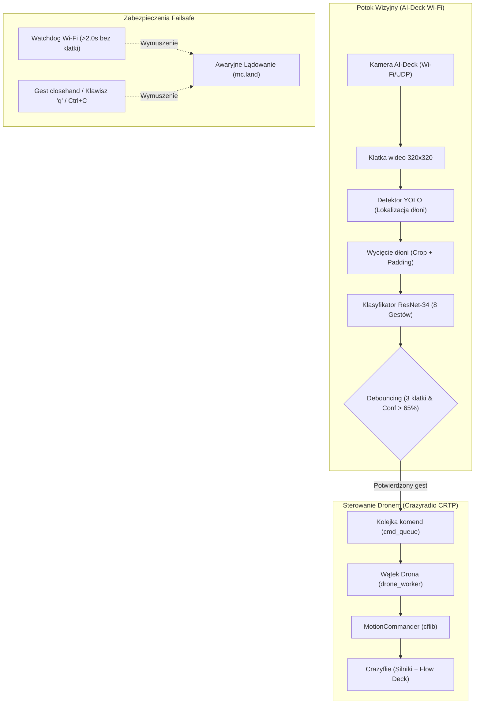

# 🚁 Crazyflie 8-Gesture Flight Controller (`gesture_flight_controller.py`)

Kompletny podręcznik obsługi skryptu do bezpiecznego, eksperymentalnego sterowania dronem **Bitcraze Crazyflie 2.1** (wyposażonym w **AI-Deck** oraz **Flow Deck v2**) za pomocą gestów dłoni rozpoznawanych na żywo przez dwustopniowy potok sztucznej inteligencji.

---

## 🏗️ 1. Architektura i Przepływ Danych



---

## ✋ 2. Tabela 8 Gestów i Odpowiadających Im Zachowań

Wszystkie ruchy w locie są zredukowane do **bezpiecznych mikro-kroków** (10 cm przy bardzo niskiej prędkości 8 cm/s), co gwarantuje stabilność i brak kolizji w pomieszczeniu laboratoryjnym/pokoju:

| Gest | Nazwa w modelu | Działanie drona | Wywołanie `MotionCommander` | Parametry |
|:---:|:---:|---|---|:---:|
| 🟢 | **`openhand`** | **1. Start z ziemi** (gdy stoi)<br>**2. Ruch w przód** (gdy w locie) | `mc.take_off()` /<br>`mc.forward(...)` | Dystans: **10 cm**<br>Prędkość: **8 cm/s** |
| 🤙 | **`shaka`** | **Ruch w tył** | `mc.back(...)` | Dystans: **10 cm**<br>Prędkość: **8 cm/s** |
| 🔵 | **`left`** | **Ruch w lewo** | `mc.left(...)` | Dystans: **10 cm**<br>Prędkość: **8 cm/s** |
| 🟣 | **`right`** | **Ruch w prawo** | `mc.right(...)` | Dystans: **10 cm**<br>Prędkość: **8 cm/s** |
| ✌️ | **`v`** | **Wznoszenie w górę** | `mc.up(...)` | Dystans: **10 cm**<br>Prędkość: **8 cm/s** |
| 👎 | **`dislike`** | **Opadanie w dół** | `mc.down(...)` | Dystans: **10 cm**<br>Prędkość: **8 cm/s** |
| 🟡 | **`ok`** | **Zatrzymanie / Zawis (Hover)** | `mc.stop()` | Zatrzymanie ruchu |
| 🛑 | **`closehand`** | **Natychmiastowe lądowanie** | `mc.land()` | Bezpieczne posadzenie drona |

---

## 🛡️ 3. Zabezpieczenia i Cykl Życia Lotu

Skrypt został wyposażony w 4 poziomy ochrony przed awarią lub niekontrolowanym zachowaniem drona:

### A. Bezpieczny start dwuetapowy (Brak auto-takeoff)
Po uruchomieniu skryptu i połączeniu radiowym dron **pozostaje na ziemi z wyłączonymi silnikami**. 
Masz pełen podgląd z kamery, aby sprawdzić oświetlenie i pozycję drona. Silniki uruchomią się dopiero po:
- pokazaniu do kamery otwartej dłoni (**`openhand`**), lub
- wciśnięciu klawisza **`t`** w oknie podglądu.

Dron unosi się na bezpieczną, niską wysokość bazową **0.40 m** (40 cm).

### B. Watchdog utraty łączności Wi-Fi (Zanik obrazu)
Jeśli transmisja wideo z AI-Deck ulegnie zerwaniu na dłużej niż **2.0 sekundy** (np. słaby zasięg Wi-Fi, zawieszenie procesora kamery), wątek drona natychmiast przerywa oczekiwanie i automatycznie bezpiecznie ląduje (`mc.land()`). Dron nie zostanie zawieszony w powietrzu do rozładowania baterii.

### C. Zabezpieczenie przed uśmierceniem wątku (Graceful Shutdown)
Wątek drona nie jest demonem (`daemon=False`). Naciśnięcie `q`, `ESC` lub `Ctrl+C` w terminalu wywołuje obsługę sygnału `SIGINT` i procedurę `drone_thread.join()`. Program nie zamknie się, dopóki Crazyflie nie potwierdzi pełnego wylądowania na ziemi.

### D. Filtr drgań gestów (Debouncing)
Aby dron nie reagował na przypadkowe machnięcie ręką, dany gest musi być odczytywany nieprzerwanie przez co najmniej **3 kolejne klatki wideo** z pewnością klasyfikatora ResNet **$\ge 65\%$**.

---

## 🖥️ 4. Elementy Widoczne na Ekranie (HUD)

1. **Górny pasek informacyjny**:
   - `AKCJA: Czeka na start (OPENHAND / 't')` (gdy dron stoi),
   - `AKCJA: PRZÓD (forward)`, `AKCJA: GÓRA (up)` itd. (w trakcie lotu).
2. **Kolorowa ramka Bounding Box**:
   - Rysowana wokół dłoni przez detektor YOLO w kolorze przypisanym do danego gestu.
   - Wyświetla nazwę gestu oraz pewność (np. `OPENHAND 98%`).
3. **Miniatura Picture-in-Picture (w prawym dolnym rogu)**:
   - Podgląd wyciętego fragmentu kadru (crop), który trafia bezpośrednio do sieci ResNet.
4. **Czujnik odległości TOF (dodatkowe okno)**:
   - Jeśli AI-Deck przesyła pakiety macierzy TOF, wyświetla się kolorowa mapa odległości w skali `TURBO`.

---

## 🎮 5. Skróty Klawiszowe w Oknie Podglądu

Gdy okno wizji jest aktywne:
| Klawisz | Działanie |
|:---:|---|
| **`t`** | **Start drona z ziemi** (wzniesienie na 0.40 m). |
| **`q`** lub **`ESC`** | **Bezpieczne zatrzymanie i lądowanie drona**, zamknięcie aplikacji. |
| **`Ctrl+C`** (w terminalu) | Przechwycenie sygnału awaryjnego i lądowanie. |

---

## 🚀 6. Instrukcja Uruchomienia Krok po Kroku

### Krok 1: Weryfikacja środowiska
Aktywuj wirtualne środowisko projektu:
```bash
cd /Users/michalskoczylas/Documents/studia/thesis/nanocockpit
source venv/bin/activate
```

### Krok 2A: Test "na sucho" (Dry-Run bez włączania silników)
Najbezpieczniejszy sposób na sprawdzenie kamerki i działania gestów:
```bash
python src/client/aideck_cpx_streamer/aideck_cpx_streamer/gesture_flight_controller.py -host aideck.local --dry-run
```
*W trybie `--dry-run` aplikacja nie łączy się z radiem Crazyflie. Wykrywane gesty wypisują się w konsoli i na pasku HUD.*

### Krok 2B: Prawdziwy lot eksperymentalny
1. Włącz drona Crazyflie i postaw go na równej, oświetlonej podłodze z widoczną teksturą (nie gładkie kafelki – Flow Deck potrzebuje kontrastu do optycznego pomiaru prędkości).
2. Podłącz Crazyradio USB do komputera.
3. Połącz komputer z siecią Wi-Fi AI-Deck (np. `Crazyflie-AP` lub wspólny router).
4. Uruchom skrypt:
```bash
python src/client/aideck_cpx_streamer/aideck_cpx_streamer/gesture_flight_controller.py -host aideck.local --uri radio://0/80/2M/E7E7E7E7E6
```
*(Uwaga: dostosuj parametr `--uri` do adresu swojego drona, np. kanał 80 lub 99).*

5. Gdy pojawi się okno podglądu, pokaż **otwartą dłoń (`openhand`)** lub naciśnij **`t`**, aby dron wystartował.
6. Steruj dronem pokazując gesty w odległości ok. 1.0 – 1.8 m przed kamerą drona.
7. Aby zakończyć, pokaż **pięść (`closehand`)** lub wciśnij klawisz **`q`**.

---

## 📋 7. Lista Opcji CLI (Flagi)

| Argument | Domyślnie | Opis |
|---|:---:|---|
| `-host` | `aideck.local` | Adres IP lub nazwa hosta Wi-Fi kamery AI-Deck. |
| `-port` | `5000` | Port transmisji strumienia wideo. |
| `--uri` | `radio://0/80/2M/E7E7E7E7E6` | Adres Crazyradio połączenia z Crazyflie. |
| `--dry-run` | `False` | Tryb symulacyjny (test wizji bez łączenia z radiem drona). |

